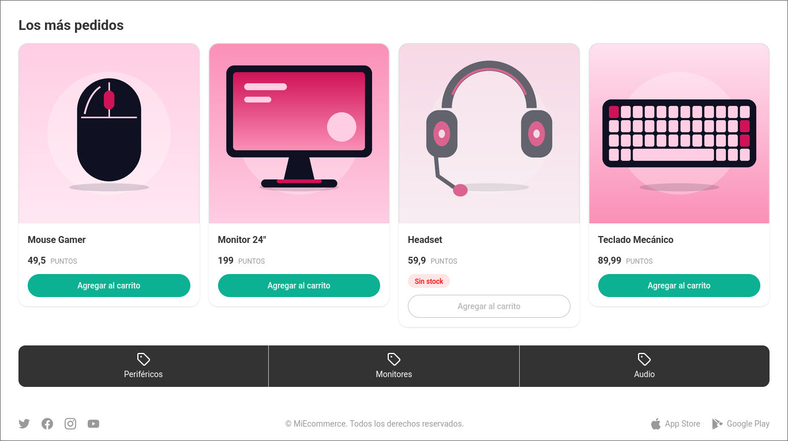
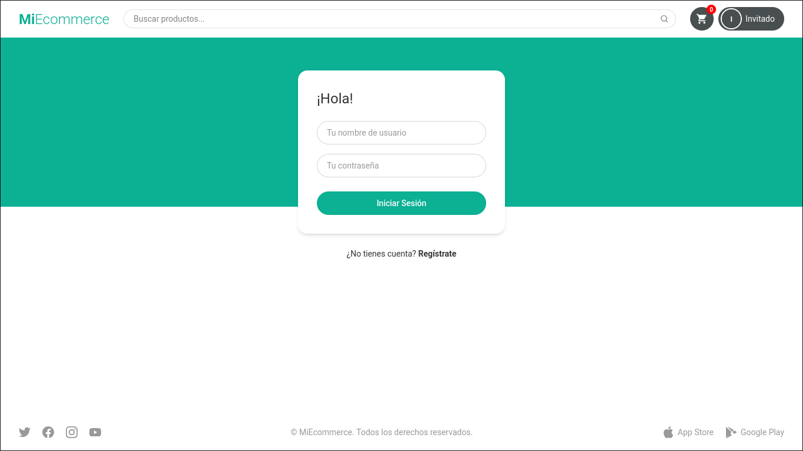
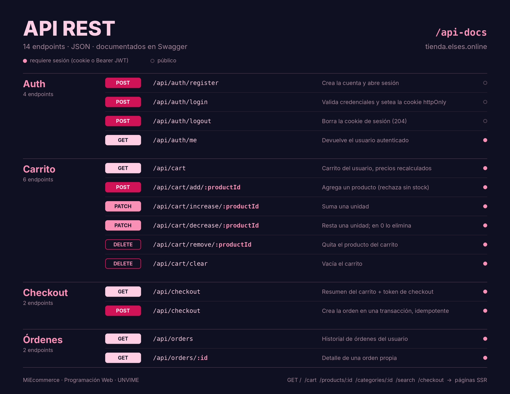

<div align="center">


<br><br>

# MiEcommerce

**Ecommerce inspirado en Mercado Libre, en TypeScript + Express + EJS.**<br>
Carrito en Redis, checkout con transacciones y login con JWT. Sin framework de frontend.

<br>

[**Demo en vivo**](https://tienda.elses.online) &nbsp;·&nbsp; [**API (Swagger)**](https://tienda.elses.online/api-docs/) &nbsp;·&nbsp; [**Instalación**](#instalación) &nbsp;·&nbsp; [**Especificación**](./spectsEccomerce/SPEC.md)

<br>


</div>

<br>

## Qué tiene de interesante

Es un trabajo práctico, pero las partes difíciles de un ecommerce están resueltas en serio y con tests:

| Problema | Cómo está resuelto |
| --- | --- |
| **Dos personas compran la última unidad** | El stock se descuenta con un `UPDATE … WHERE stock >= ?` dentro de una transacción `BEGIN IMMEDIATE`. En el test, 8 procesos compiten por 1 unidad: gana exactamente uno. |
| **El usuario aprieta "Comprar" dos veces** | Cada checkout lleva un token único. Reenviar el formulario devuelve la orden ya creada, no una nueva. |
| **El precio cambia después de la compra** | `order_items.unit_price` queda congelado al momento de comprar. |
| **Alguien manipula precios desde el navegador** | El carrito guarda solo `{ productId, quantity }`. Los precios se recalculan siempre desde SQLite. |
| **Robo de sesión** | JWT en cookie `httpOnly` + `SameSite=Lax` + chequeo de `Origin` en toda mutación (CSRF, sin librería). Contraseñas con bcrypt, y el login tarda lo mismo exista o no el email. |
| **Se cae Redis** | Catálogo y login siguen andando. Solo fallan carrito y checkout. |

<br>

## Capturas

<table>
  <tr>
    <td width="50%"></td>
    <td width="50%"></td>
  </tr>
  <tr>
    <td align="center"><sub>Catálogo, con el estado <i>Sin stock</i> bloqueando el botón</sub></td>
    <td align="center"><sub>Login y registro con validación en cliente y servidor</sub></td>
  </tr>
</table>

<sub>Los diseños no son propios: los dio la cátedra como recurso. Las ilustraciones de producto de estas capturas son de ejemplo; en la app, un producto sin `image_url` muestra la imagen de fallback configurable.</sub>

<br>

## Instalación

Necesitás **Node 22+** y **Redis**. Si no tenés Redis, levantalo con Docker:

```bash
docker run -d --name redis-dev -p 6379:6379 redis:7-alpine
```

Después:

```bash
git clone https://github.com/Elses2/Ecommerce-Two
cd Ecommerce-Two
npm run init   # instala, crea .env, compila y carga datos de ejemplo
npm run dev
```

Abrí <http://localhost:3000>. La documentación de la API queda en <http://localhost:3000/api-docs>.

<details>
<summary><b>Si <code>npm run init</code> falla compilando <code>better-sqlite3</code></b></summary>

<br>

`better-sqlite3` es un módulo nativo y en algunos sistemas se compila con `node-gyp`, que necesita **Python 3**.

- Instalá Python desde [python.org](https://python.org). En Windows, marcá **"Add python.exe to PATH"**.
- En Windows también puede hacer falta [Visual Studio Build Tools](https://visualstudio.microsoft.com/visual-cpp-build-tools/) con el workload **"Desktop development with C++"**.
- Volvé a correr `npm run init`.

</details>

<details>
<summary><b>Variables de entorno</b></summary>

<br>

`npm run init` crea el `.env` desde `.env.example` solo si no existe, así que nunca pisa el tuyo.

| Variable | Para qué sirve | Nota |
| --- | --- | --- |
| `JWT_SECRET` | Firma de los tokens | Generalo con `openssl rand -hex 48`. En producción es obligatorio y de 32+ caracteres. |
| `REDIS_URL` | Conexión al carrito | Default `redis://localhost:6379`. |
| `COOKIE_SECURE` | Cookie con flag `Secure` | `false` salvo que sirvas por HTTPS. Si la activás y entrás por `http://`, la sesión no se mantiene. |
| `CSP_UPGRADE_INSECURE` | Fuerza HTTPS en `/css` y `/js` | `false` salvo detrás de HTTPS. Con `http://IP:PUERTO` en `true`, la página sale sin estilos. |
| `FALLBACK_IMAGE_URL` | Imagen de productos sin foto | Se puede dejar el default. |
| `JWT_EXPIRES_IN` | Vida del token | Default `2h`. |
| `DB_PATH` | Archivo SQLite | Default `dev.db`. |
| `SEED_ADMIN_EMAIL` / `SEED_ADMIN_PASSWORD` | Crea un usuario admin en el seed | Opcionales. Sin ellas, el seed omite el admin. |

</details>

<br>

## API

14 endpoints JSON. Los de carrito, checkout y órdenes requieren sesión (cookie o `Authorization: Bearer`).



<details>
<summary><b>Misma tabla en texto</b></summary>

<br>

| Método | Ruta | Sesión | Qué hace |
| --- | --- | :---: | --- |
| `POST` | `/api/auth/register` | — | Crea la cuenta y abre sesión |
| `POST` | `/api/auth/login` | — | Valida credenciales y setea la cookie |
| `POST` | `/api/auth/logout` | — | Borra la cookie (204) |
| `GET` | `/api/auth/me` | ✓ | Devuelve el usuario autenticado |
| `GET` | `/api/cart` | ✓ | Carrito con precios recalculados |
| `POST` | `/api/cart/add/:productId` | ✓ | Agrega un producto (rechaza sin stock) |
| `PATCH` | `/api/cart/increase/:productId` | ✓ | Suma una unidad |
| `PATCH` | `/api/cart/decrease/:productId` | ✓ | Resta una unidad; en 0 lo elimina |
| `DELETE` | `/api/cart/remove/:productId` | ✓ | Quita el producto |
| `DELETE` | `/api/cart/clear` | ✓ | Vacía el carrito |
| `GET` | `/api/checkout` | ✓ | Resumen del carrito y token de checkout |
| `POST` | `/api/checkout` | ✓ | Crea la orden, idempotente por token |
| `GET` | `/api/orders` | ✓ | Historial de órdenes del usuario |
| `GET` | `/api/orders/:id` | ✓ | Detalle de una orden propia |

Páginas renderizadas en servidor: `/`, `/products`, `/products/:id`, `/categories/:id`, `/search?query=`, `/cart`, `/checkout` y `/checkout/confirmation/:token`. `/cart` y `/checkout` redirigen a `/login` si no hay sesión.

</details>

<br>

## Cómo está armado

Monolito en capas. Cada capa conoce solo a la de abajo:

```
Controller  →  Service  →  Repository  →  SQLite (better-sqlite3)
 orquesta      lógica       único que       Redis (solo el carrito)
               de negocio   toca datos
```

Las vistas siguen **Atomic Design** (`atoms → molecules → organisms → pages`) y un componente solo se extrae si se reutiliza en dos o más lugares.

| | |
| --- | --- |
| **Backend** | TypeScript, Express, `better-sqlite3`, Redis, JWT, bcrypt |
| **Vistas** | EJS, Tailwind CSS, JavaScript sin framework |
| **Docs de la API** | swagger-jsdoc + swagger-ui-express |
| **Infra** | Docker multi-stage, GitHub Actions, GitHub Container Registry |

El detalle de cada decisión está en [`SPEC.md`](./spectsEccomerce/SPEC.md), la especificación viva del proyecto.

<br>

## Scripts y tests

| Comando | Qué hace |
| --- | --- |
| `npm run init` | Instala, crea `.env`, compila y carga el seed |
| `npm run dev` | Servidor de desarrollo (`tsx watch` + Tailwind watch) |
| `npm run build` | Compila a `dist/` |
| `npm run seed` | Carga datos de ejemplo (se puede correr varias veces sin duplicar) |
| `npm run test:checkout` | Checkout, casos T1–T7: stock, rollback, idempotencia, precio congelado, carrera entre procesos |
| `npm run test:middlewares` | Middlewares, casos M1–M26: CSP, 404, ids, CSRF, auth, error handler. Requiere `npm run build` |
| `npm run test:auth` | Auth, casos A1–A11: registro, login, tokens vencidos o manipulados, roles, cookie |
| `npm run test:cart` | Carrito en Redis, casos C1–C6: aislamiento entre usuarios, concurrencia, persistencia |
| `npm run build:docs` | Regenera `docs/` (TypeDoc + grafo de dependencias, requiere Graphviz) |

Los tests usan una base SQLite temporal y nunca tocan `dev.db`. Terminan con exit code distinto de 0 si algo falla. `test:cart` usa la base `/15` de Redis y solo hace `FLUSHDB` si la URL apunta ahí.

<br>

## Despliegue

Al mergear un Pull Request a `main`, GitHub Actions corre build y tests, y si pasan publica la imagen Docker en `ghcr.io`. En el servidor, [`docker-compose.prod.yml`](./docker-compose.prod.yml) levanta la app (puerto `18480`) y Redis.

```bash
# 1. Crear un .env junto al compose (ver .env.prod.example)
#    JWT_SECRET=<openssl rand -hex 48>
#    REDIS_PASSWORD=<openssl rand -hex 24>

# 2. Levantar los servicios
docker compose -f docker-compose.prod.yml up -d

# 3. Cargar datos de ejemplo (solo la primera vez)
docker compose -f docker-compose.prod.yml run --rm tienda npm run seed

# Para actualizar después de un cambio
docker compose -f docker-compose.prod.yml pull && docker compose -f docker-compose.prod.yml up -d
```

SQLite y Redis guardan sus datos en carpetas del servidor (`/mnt/nas/EcommerceTwo/data` y `/redis`). Redis no expone puertos: solo lo ve la app. Si servís por HTTPS, poné `COOKIE_SECURE=true` y `CSP_UPGRADE_INSECURE=true` en el `.env`. Los secretos viven ahí, nunca en la imagen. Más detalle en [`SPEC.md §21`](./spectsEccomerce/SPEC.md#21-cicd-y-despliegue).

<br>

## Documentación

- [`SPEC.md`](./spectsEccomerce/SPEC.md): única especificación que se edita. Los demás `.md` de `spectsEccomerce/` son históricos. Los comentarios `(spec §X.Y)` del código apuntan acá.
- `docs/`: HTML generado con TypeDoc más el grafo de dependencias (`docs/graphs/dependencias.svg`). Si cambia la arquitectura, regeneralo con `npm run build:docs` y commiteá el resultado.

<br>

## Equipo

Proyecto de **Programación Web**, **Universidad Nacional de Villa Mercedes (UNVIME)**.

**Estudiantes:** Martín Mozainer · Eber Chiecher<br>
**Profesor titular:** Walter Molina<br>
**Profesor auxiliar:** Ing. Micael Latorre

### Colaboradores

<a href="https://github.com/Elses2/Ecommerce-Two/graphs/contributors">
  
</a>
